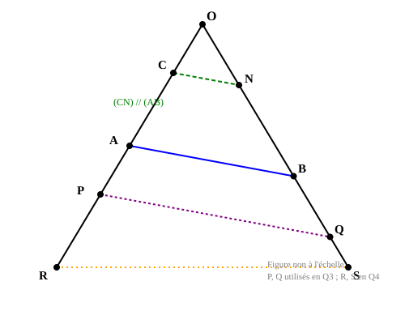
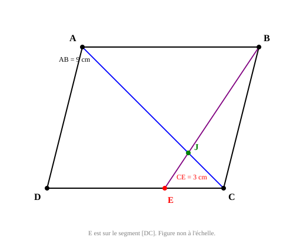
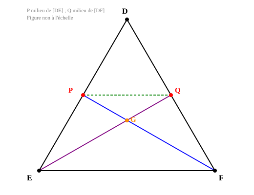
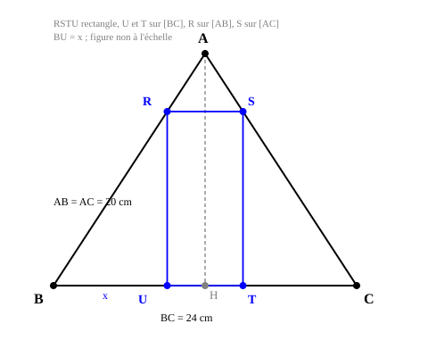
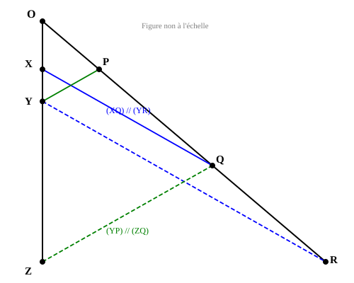
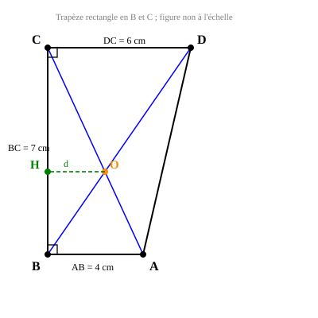

# Exercice — Thalès (Feuille 9)

**Matière** : Mathématiques — 3ème
**Chapitre** : Thalès — théorème, réciproque, contraposée
**Date** : 2026-10-26

**Notions** : théorème de Thalès (configuration du point) ; réciproque du théorème de Thalès ; contraposée ; parallélogramme et configuration en « papillon » ; démonstration par point auxiliaire ; théorème de la droite des milieux ; Pythagore ; trapèze et diagonales ; proportionnalité (longueurs réelles).

---

## Énoncé

**Rappels et données pour toute la feuille**

- **Réciproque du théorème de Thalès** : Si les points A, B, M d'une part et A, C, N d'autre part sont alignés dans le même ordre, et si AM/AB = AN/AC, alors les droites (BC) et (MN) sont parallèles.
- **Contraposée du théorème de Thalès** : Si les droites (BM) et (CN) sont sécantes en A et si AM/AB ≠ AN/AC, alors les droites (BC) et (MN) ne sont pas parallèles.
- Dans un triangle, le segment reliant les milieux de deux côtés (**droite des milieux**) est parallèle au troisième côté et a pour longueur la moitié de celle de ce côté.
- Toute figure est donnée **non à l'échelle**, sauf mention contraire.

1. Compléter l'énoncé du théorème de Thalès :

   « Si les droites (.......) et (.......) sont sécantes en A, et si les droites (BC) et (MN) sont ................., alors AM/....... = AN/....... = ......./BC. »

2. On considère la figure ci-dessous : le point O, et deux demi-droites sur lesquelles sont placés C, A (demi-droite 1) et N, B (demi-droite 2), avec (CN) parallèle à (AB).

   

   On donne OC = 4 cm, OA = 10 cm, OB = 7,5 cm et AB = 9 cm.
   Calculer la longueur CN.

3. On reprend la figure précédente. On place P sur la demi-droite [OA) tel que OP = 14 cm, et Q sur la demi-droite [OB) tel que OQ = 10,5 cm.

   Les droites (AB) et (PQ) sont-elles parallèles ? Justifier la réponse.

4. On reprend la même figure. On place R sur la demi-droite [OA) tel que OR = 20 cm, et S sur la demi-droite [OB) tel que OS = 12 cm.

   Les droites (AB) et (RS) sont-elles parallèles ? Justifier la réponse.

5. ABCD est un parallélogramme. E est un point du segment [DC] tel que CE = 3 cm, et AB = 9 cm. La droite (BE) coupe la diagonale (AC) en J.

   

   a) Démontrer que JA = (3/4)AC.
   b) On donne AC = 16 cm. Calculer JA et JC.
   c) On donne BE = 12 cm. Calculer JB et JE.

6. Soit DEF un triangle. P est le milieu de [DE] et Q est le milieu de [DF]. Les droites (FP) et (EQ) se coupent en G.

   

   a) Démontrer que (PQ) est parallèle à (EF) et que PQ = (1/2)EF.
   b) En déduire, en utilisant la configuration formée par les droites (FP) et (EQ), que EG = (2/3)EQ.
   c) On donne EQ = 9 cm. Calculer EG et GQ.

7. ABC est un triangle isocèle de sommet A tel que AB = AC = 20 cm et BC = 24 cm. H est le pied de la hauteur issue de A. RSTU est un rectangle tel que U et T sont sur [BC], R sur [AB] et S sur [AC], avec BU = x.

   

   a) Démontrer que AH = 16 cm.
   b) Justifier que RS = 24 − 2x et que RU = (4/3)x.
   c) Le périmètre de RSTU vaut 36 cm. Calculer x, puis les longueurs RS et RU.
   d) Comparer l'aire du rectangle RSTU et l'aire du triangle ABC.

8. On considère un point O, et deux demi-droites : l'une portant les points X, Y, Z dans cet ordre, l'autre portant les points P, Q, R dans cet ordre. On donne (XQ) parallèle à (YR), et (YP) parallèle à (ZQ).

   

   a) Démontrer que OX/OY = OQ/OR et que OY/OZ = OP/OQ.
   b) En déduire que OX × OR = OZ × OP.
   c) Qu'en conclut-on pour les droites (XP) et (ZR) ?

9. ABCD est un trapèze rectangle en B et en C, avec AB = 4 cm, DC = 6 cm et BC = 7 cm. O est le point d'intersection des diagonales (AC) et (BD). Soit H le pied de la perpendiculaire menée de O à (BC), et d la distance de O à (BC).

   

   Coup de pouce : exprimer d/AB et d/DC à l'aide des triangles formés par les diagonales, en déduire une équation vérifiée par d, puis calculer d.

10. Une personne mesurant 1,60 m est debout au soleil ; son ombre mesure 2 m. Au même moment, un arbre voisin projette une ombre de 7,5 m sur le sol horizontal. Les rayons du soleil sont supposés parallèles.

    Calculer la hauteur de l'arbre.
